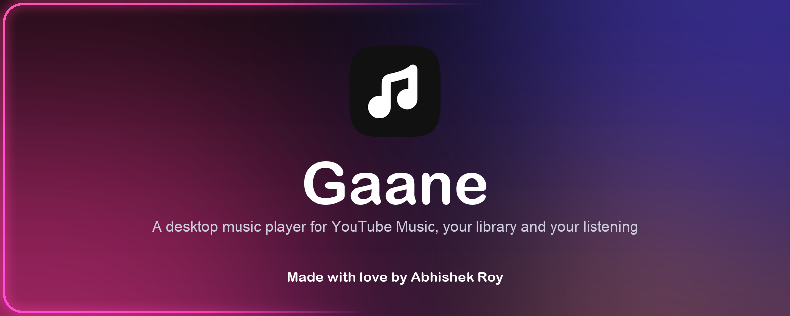
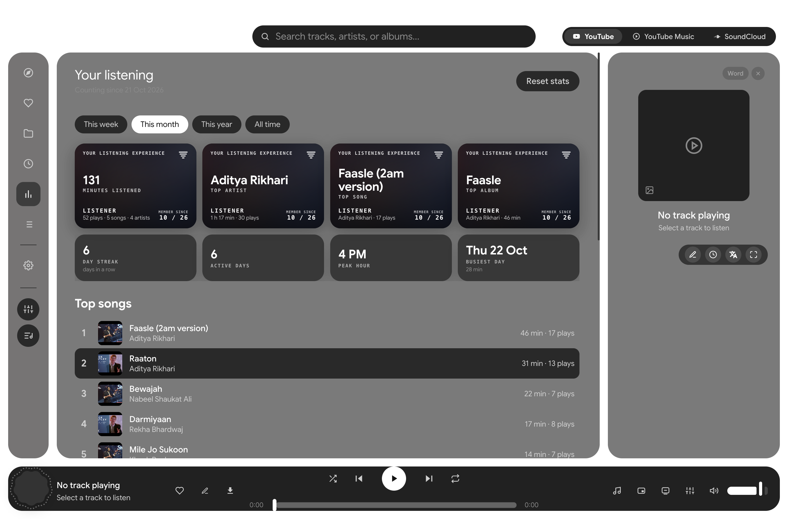

<p align="center">
  
</p>

<h1 align="center">Gaane</h1>

<p align="center">
  A desktop music player for macOS (also Windows and Linux builds) that plays YouTube, YouTube Music, SoundCloud and your own files, and shows you how you listen.<br>
  Made with love by <a href="https://www.abhishekkroy.me">Abhishek Roy</a>.
</p>

---

## What's new in 1.2.1

- **Live wallpaper (macOS).** Settings, Live backdrop: draw the backdrop as your desktop wallpaper on every screen, behind your icons and windows, moving with the music. (macOS does not allow apps to draw on the lock screen.)
- **Better Live backdrop.** Two new lit 3D voxel scenes (Voxel city, Voxel dunes) next to the dotted and flat ones, all in the cover's colours.
- **Verse lyrics.** Word-by-word lyrics in eight styles (Reel, Glide, Elastic, Cascade, Orbit, Surge, Echo, Halo) with colour harmonies from the cover.
- **Lyrics in time with what you hear.** The lyric clock allows for output delay (Bluetooth), the next song's lyrics are fetched ahead, and each song has its own timing nudge.
- **One-time YouTube Music login.** Gaane refreshes the session itself like a browser does and never signs you out on a hiccup. Connect from a private window and close it afterwards.
- **A tidier ambient settings panel:** scrolls, with collapsible groups and smaller buttons.

## What's new in 1.2

- **Word-by-word lyrics from many sources.** Gaane asks lrc.red, BiniLyrics, LyricsPlus, BetterLyrics, Unison and LRCLIB at once and uses the best answer, preferring lyrics timed to each word. Fixed lyrics that got stuck on one line when a source sent unsynced text.
- **Search suggestions** while you type (from YouTube Music), plus your recent searches.
- **A queue that behaves like the big apps.** Playing a song from search plays just that song, then similar songs (not the next search result). Songs you add by hand play before the rest, shuffle plays each song once, and repeat now goes off, all, one. Clear queue removes only what you added. The Queue page says where the music comes from.
- **Smoother edge light.** One cover colour flows into the next instead of separate blocks.
- **Live backdrop** (Settings, Appearance): Aurora, Voxel wall, Contours or Ripples, moving with the music in the cover's colours, in ambient mode or behind the whole app.
- **Verse lyrics view** in ambient mode: very large lyrics where each word rises into place as it is sung.
- **Scrobble to ListenBrainz**, **Stats for nerds** panel, and a click on the total time to see the time remaining.

## What's new in 1.0

- **Your YouTube Music, inside Gaane.** Connect your account and your Home (Quick picks, Speed dial, Listen again, mixes, mood chips and more), Explore, liked songs, library and history appear in the app, laid out like YouTube Music.
- **One Home.** My Wave when you are signed out, your YouTube Music Home when you are connected. One place to browse everything.
- **Liked songs are combined.** Favorites shows your Gaane favorites and your YouTube Music likes as one list.
- **Your listening.** Minutes listened, top artist, top song, top album, plus streak, peak hour and busiest day, for this week, month, year or all time. Everything is counted on your Mac only.
- **Ambient fullscreen.** Lyrics, visualizer and controls on a calm backdrop, with a thin light around the whole screen (curving around the notch) that uses only the colours of the cover and moves with the music.
- **Pinned mini player.** A Now Playing style card that stays on top of every app and desktop, with minimise, normal view, fullscreen and close.
- **Frosted window on macOS.** Your wallpaper shows as a plain blur behind every screen.
- **Branded installer** with a drag-to-Applications window.
- **Better playback** (Settings, Playback):
  - **Crossfade** (0 to 12 s) that is a real overlap: the song that is ending keeps playing on a second deck while the next one fades in.
  - **Automix [Beta]**, in the spirit of Apple Music's: it analyses each song (tempo, outro, key), starts the blend on a beat of the outgoing song, speeds the incoming song up or down by a few percent to match the tempo, lines up the beats, swaps the bass across the blend, gives songs in compatible keys a longer blend and clashing keys a short one, and skips a silent intro.
  - **Skip silence**, **Spatial audio** (stereo widening) and **AutoPlay** (similar songs when the queue runs out, from YouTube Music's radio).

<p align="center">
  
</p>

## Features

- Plays **YouTube, YouTube Music and SoundCloud**, plus local FLAC, WAV, MP3, OGG and M4A files
- Synced lyrics (with a fullscreen view), 10-band equalizer, tempo, pitch, reverb and a simple audio editor
- Downloads with tags and cover art, playlists, playlist import (Spotify, Apple Music, YouTube Music, SoundCloud)
- Themes with colours taken from the album art, a CSS editor and plugins
- Keyboard shortcuts (Space, M mute, H shuffle, R repeat, F fullscreen ambient, P mini player)
- Discord Rich Presence

## Install (macOS, Apple Silicon)

1. Download `Gaane-<version>-mac-arm64.dmg` from the Releases page and open it.
2. Drag **Gaane** onto **Applications**.
3. The app is not signed, so the first time right-click it and choose **Open**. If macOS says it is damaged, run:
   ```bash
   xattr -cr /Applications/Gaane.app
   ```
4. For YouTube playback and downloads, install the helper tools once:
   ```bash
   brew install yt-dlp ffmpeg
   ```

Gaane ejects its own installer disk the first time you open it from Applications.

## Connect YouTube Music

Google does not allow sign-in inside apps, so Gaane uses a session from your own browser, once:

1. Open music.youtube.com in your browser and make sure you are signed in.
2. Open the developer tools, go to the Network tab, reload, click any request to music.youtube.com and copy the value of its **Cookie** request header.
3. In Gaane, click **Connect YouTube Music** on Home, paste the value and press Connect.

The cookie is stored encrypted on your Mac and only sent to YouTube Music. Treat it like a password. Disconnect any time from Home.

## Run from source

Requires Node.js 18 or newer.

```bash
npm install
npm start          # development
npm test           # unit tests
npm run dist:dmg   # build the macOS DMG into dist/
```

## Privacy

No telemetry. Settings, your listening stats and your library stay on your machine.

## Credits and licence

Gaane started from the open-source Riff player (MIT). The listening-stats, queue and lyrics-source ideas were inspired by BitChord, and the live backdrop and Verse view are original work inspired by the idea of music-reactive wallpapers (they use none of VoxelWall's code or art); Automix is written from scratch for Gaane (BitChord's own Automix engine is AGPL and is not used). See [LICENSE](LICENSE).
