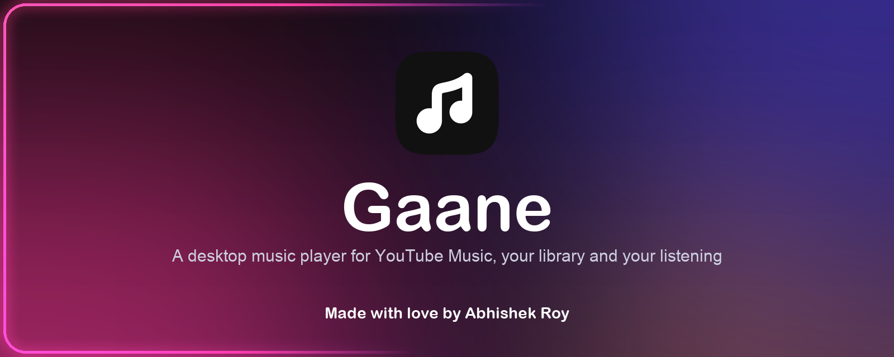
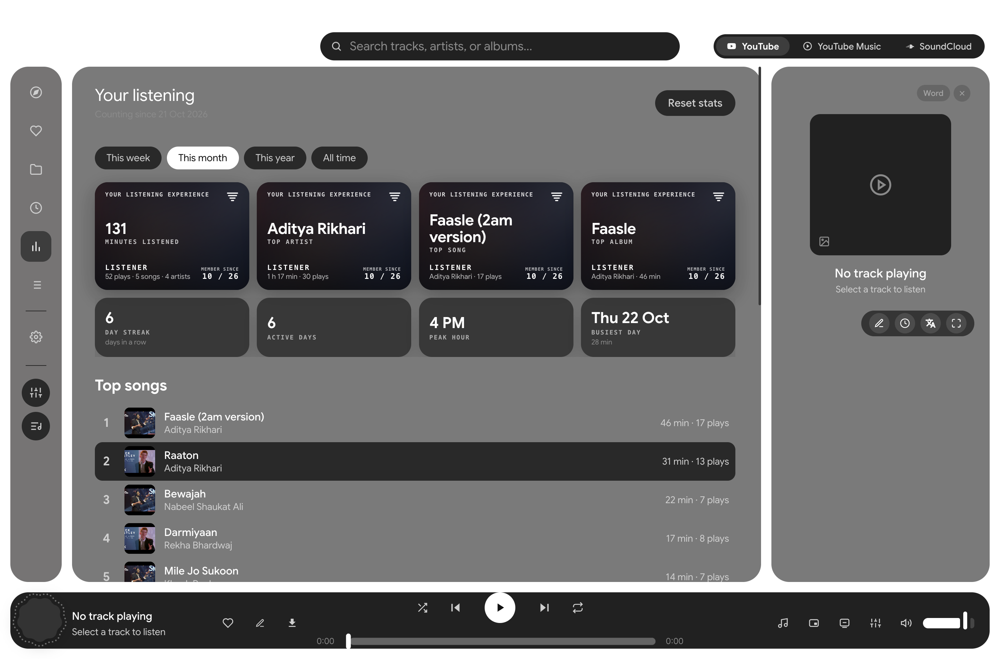
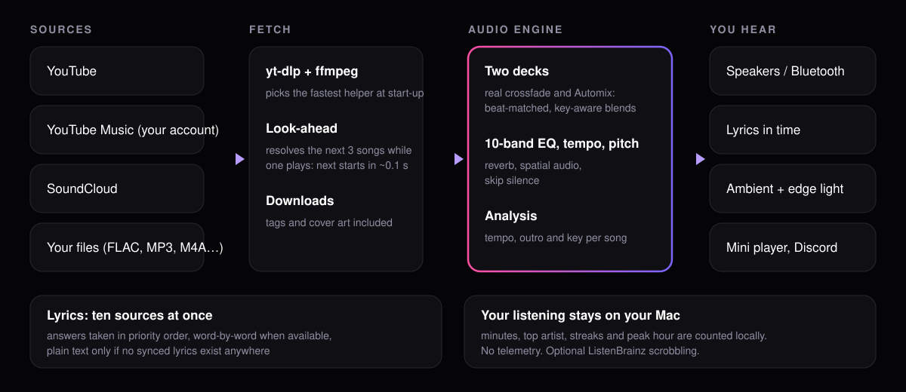

<div align="center">



<br/>

**A music player that plays YouTube, YouTube Music, SoundCloud and your own files, blends songs like a DJ, shows lyrics in time, and tells you how you listen.**
Everything about your listening stays on your computer.

<br/>

[](../../releases/latest)


[Features](#-features) · [Screenshots](#-screenshots) · [Install](#-install) · [Connect YouTube Music](#-connect-youtube-music) · [How it works](#-how-it-works) · [Run from source](#-run-from-source) · [Changelog](CHANGELOG.md)

</div>

<br/>

## ✨ What it feels like

You press play and the song starts at once, because Gaane already looked up the next three. When one song ends, the next one is blended in on a beat, in a compatible key. Lyrics light up word by word. Go fullscreen and a soft light follows the cover's colours around your screen. At the end of the week you see your minutes, your top artist and your streak, counted on your own machine.

## 🚀 Features

<table>
<tr>
<td width="50%" valign="top">

### 🎧 Play everything
**YouTube, YouTube Music and SoundCloud**, plus local FLAC, WAV, MP3, OGG and M4A. Search with live suggestions and recent searches. Your YouTube Music **Home, Explore, likes, library and history** appear inside the app.

</td>
<td width="50%" valign="top">

### 🔀 Blends like a DJ
**Crossfade** (0 to 12 s) is a real overlap on two decks. **Automix [Beta]** analyses tempo, outro and key, starts the blend on a beat, matches tempo, swaps the bass across the blend, and skips silent intros.

</td>
</tr>
<tr>
<td width="50%" valign="top">

### 📝 Lyrics in time
Ten sources asked at once, answers taken in priority order, **word-by-word** when available, a fullscreen view, a translate option (including Hinglish) and a timing nudge per song.

</td>
<td width="50%" valign="top">

### 📊 Your listening
Minutes listened, top artist, song and album, streak, peak hour and busiest day for the week, month, year or all time. **Counted only on your computer.**

</td>
</tr>
<tr>
<td width="50%" valign="top">

### 🌌 Ambient fullscreen
Lyrics, visualizer and controls on a calm backdrop, with a thin light around the whole screen (curving around the notch) in the cover's own colours.

</td>
<td width="50%" valign="top">

### 🎚️ Sound your way
10-band equalizer, tempo, pitch, reverb, **spatial audio**, skip silence, a simple audio editor, and downloads with tags and cover art.

</td>
</tr>
<tr>
<td width="50%" valign="top">

### 🧩 A pinned mini player
A Now Playing card that stays above every app, plus keyboard shortcuts: `Space`, `M` mute, `H` shuffle, `R` repeat, `F` ambient, `P` mini player.

</td>
<td width="50%" valign="top">

### 🔌 Make it yours
Themes with colours taken from the album art, a CSS editor and plugins. Playlist import from Spotify, Apple Music, YouTube Music and SoundCloud. Discord Rich Presence. Optional ListenBrainz scrobbling.

</td>
</tr>
</table>

## 📸 Screenshots

<div align="center">

</div>

## 📦 Install

**macOS (Apple silicon)**

1. Download `Gaane-<version>-mac-arm64.dmg` from [Releases](../../releases/latest) and open it.
2. Drag **Gaane** onto **Applications**.
3. The app is not signed. The first time, right-click it and choose **Open**. If macOS says it is damaged, run:
   ```bash
   xattr -cr /Applications/Gaane.app
   ```
4. For YouTube playback and downloads, install the helper tools once:
   ```bash
   brew install yt-dlp ffmpeg
   ```

Gaane ejects its own installer disk the first time you open it from Applications.

## 🔑 Connect YouTube Music

Press **Connect** on Home and sign in on Google's own page, in a browser window that Gaane opens and closes for you. It uses your default browser if that is Chrome, Brave, Edge or Arc, otherwise another one you have installed (Safari cannot be used for this step). No cookie copying. The window is a private profile of its own, so your login stays put.

Your session is stored encrypted on your computer and only sent to YouTube Music. Disconnect any time from the account menu.

## 🧠 How it works

<div align="center">

</div>

## 🛠️ Run from source

Needs Node.js 18 or newer.

```bash
npm install
npm start          # development
npm test           # unit tests
npm run dist:dmg   # build the macOS DMG into dist/
```

## 🔒 Privacy

No telemetry. Your settings, your listening stats and your library stay on your machine.

## 🤝 Credits and licence

Gaane started from the open-source Riff player (MIT). The listening-stats, queue and lyrics-source ideas were inspired by BitChord, and the live backdrop and Verse view are original work inspired by the idea of music-reactive wallpapers (they use none of VoxelWall's code or art); Automix is written from scratch for Gaane (BitChord's own Automix engine is AGPL and is not used). See [LICENSE](LICENSE).

---

<div align="center">

**Made with ♥ by [Abhishek Roy](https://www.abhishekkroy.me)**

</div>
